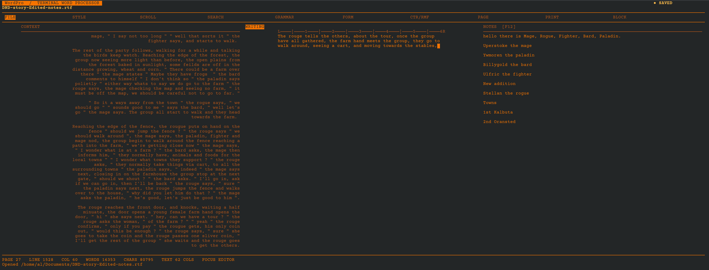

# WordPro

**A retro-inspired terminal word processor written in Python.**

WordPro brings the feel of a classic dedicated word processor to a modern Linux terminal, with an amber-on-dark interface, keyboard-driven menus, document formatting, and local proofreading tools.





## Features

- Terminal-based, keyboard-driven editing.
- Open and save Rich Text Format (`.rtf`) and plain-text (`.txt`) documents.
- Automatic line wrapping while editing.
- Paragraph styles including Normal and Heading 1–3, with adjustable font size.
- Page layouts, margins, page breaks, headers, footers, and page numbering.
- Search and replace, text alignment, word count, and a built-in thesaurus.
- Print preview.
- Spell checking through optional Hunspell integration, with a bundled US English dictionary.
- Built-in grammar checks, with optional integration with a local LanguageTool server.
- Recovery drafts and backups to help protect unsaved work.

## Requirements

- Linux or another Unix-like system with a terminal.
- Python 3 with `curses` support.

Optional features:

- Hunspell for dictionary-based spell checking.
- Java 17 or newer, `unzip`, and `curl` or `wget` for the optional LanguageTool installer.

## Run from source

```bash
git clone https://github.com/laal75/WordPro.git
cd WordPro
python3 wordpro.py
```

## Install for your user

```bash
chmod +x install.sh
./install.sh --user
```

This installs WordPro under your home directory and adds a desktop menu entry. You can then run `wordpro` or launch it from your applications menu.

For a system-wide installation:

```bash
sudo ./install.sh --system
```

To install the optional standalone LanguageTool server as part of setup:

```bash
./install.sh --user --with-languagetool
```

This downloads LanguageTool (approximately 252 MB); Java 17 or newer is required. WordPro can also use an existing local LanguageTool server by setting `WORDPRO_LANGUAGETOOL_URL`. Without LanguageTool, built-in grammar checks remain available.

See [`INSTALL.txt`](INSTALL.txt) for full installation and uninstall instructions.

## Usage

Run `python3 wordpro.py` or launch WordPro from your applications menu. The startup screen lists `.rtf` and `.txt` files in the current folder. Use the arrow keys to select a document and press Enter to open it; Esc starts a new document.

Useful shortcuts include:

| Shortcut | Action |
| --- | --- |
| `Ctrl+S` | Save as RTF |
| `Ctrl+O` | Open a document |
| `Ctrl+Enter` | Insert a page break |
| `Page Up` / `Page Down` | Move by a visible page |
| `F1`–`F10` | Open a menu |
| `Ctrl+D` or `Ctrl+C` | Start quit confirmation |

New documents are saved as `Document N.rtf` in the current folder. Recovery drafts and document state are stored under `~/.local/state/wordpro` (or the directory specified by `XDG_STATE_HOME`).

## Dictionary licensing

WordPro includes an English (US) Hunspell dictionary. Its original licence and attribution notices are preserved in [`dictionaries/LICENSE.txt`](dictionaries/LICENSE.txt). See [`THIRD-PARTY-NOTICES.md`](THIRD-PARTY-NOTICES.md) for an overview. The dictionary's terms are separate from the licence for WordPro's own source code.

## Project status

WordPro is done. Although Features and behaviour may change. Bug reports, suggestions, and contributions are welcome; please open an issue with steps to reproduce any problem.

## Licence

A project licence for WordPro's own source code has not yet been selected. Until one is added, do not assume the project is available under a particular open-source licence. Third-party dictionary terms remain in `dictionaries/LICENSE.txt`.
